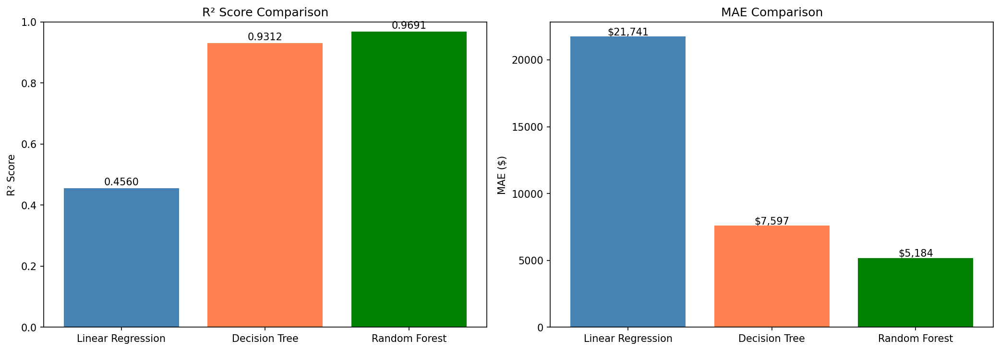
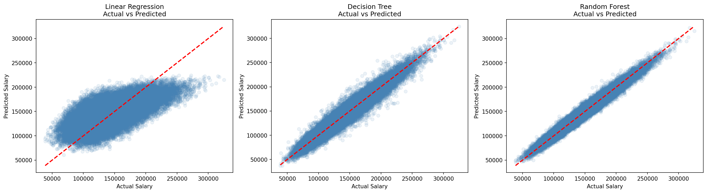
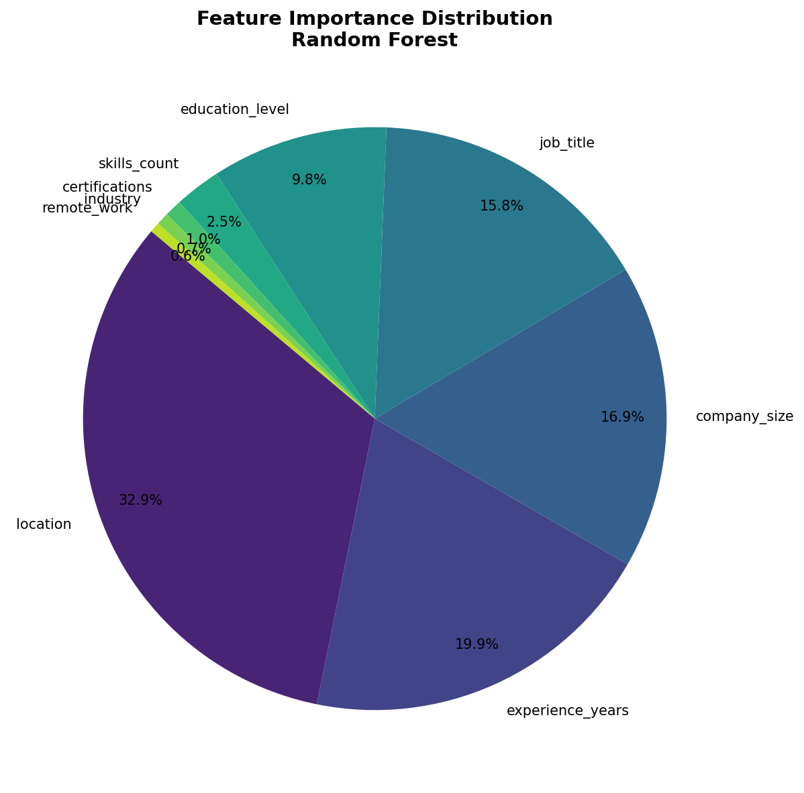
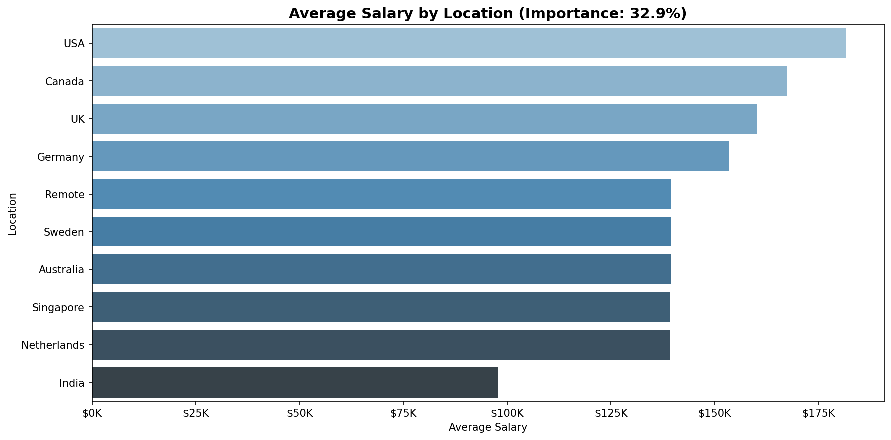
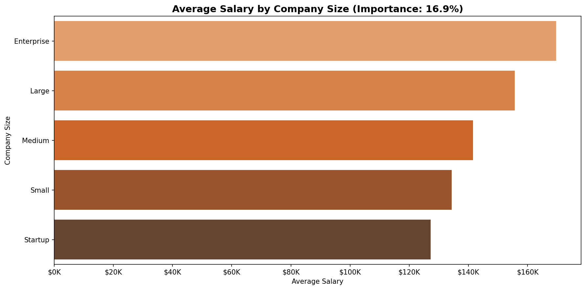
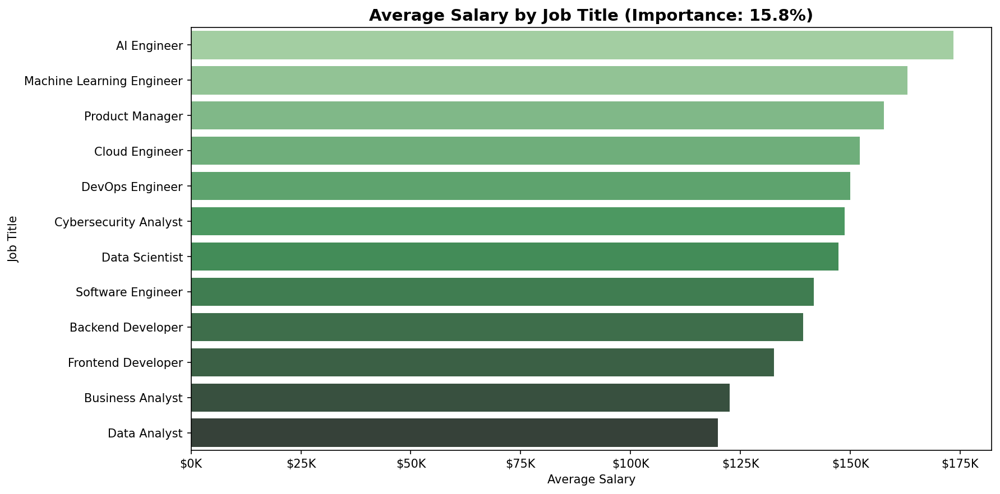
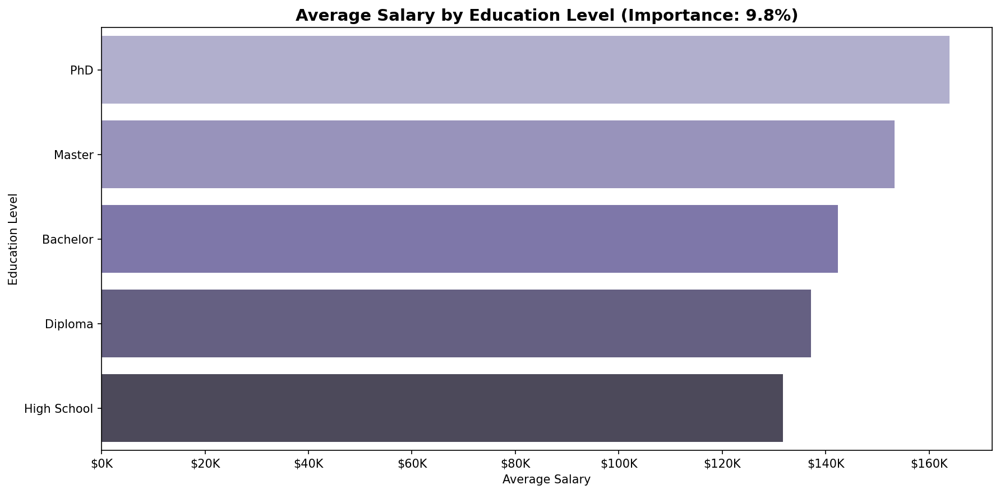

# Job Salary Prediction

A machine learning project that predicts annual salary from job and candidate attributes. It compares three regression models and analyzes which factors drive salary the most.

*Team course project (Machine Learning, University of Jeddah). I implemented the full pipeline: preprocessing, modeling and evaluation. Dataset from Kaggle.*

## Overview

- **Goal:** predict `salary` (regression) from 9 features
- **Dataset:** 250,000 job records, 10 columns, no missing values or duplicates
- **Models:** Linear Regression, Decision Tree, Random Forest (100 trees)
- **Best model:** Random Forest, with **R² = 0.969** and **MAE ≈ $5,184** on the test set

## Dataset

| Feature | Type | Description |
|---|---|---|
| `job_title` | categorical | 12 roles (e.g. Data Analyst, AI Engineer, Product Manager) |
| `experience_years` | numeric | 0–20 years |
| `education_level` | categorical | High School, Diploma, Bachelor, Master, PhD |
| `skills_count` | numeric | 1–19 skills |
| `industry` | categorical | 10 industries |
| `company_size` | categorical | Startup, Small, Medium, Large, Enterprise |
| `location` | categorical | 10 countries |
| `remote_work` | categorical | Yes / No / Hybrid |
| `certifications` | numeric | 0–5 |
| **`salary`** | **target** | $31,867 – $333,046 (mean ≈ $145,718) |

## Workflow

1. **EDA:** summary statistics, data types, missing-value and duplicate checks, unique values per column
2. **Preprocessing:** label encoding of 6 categorical columns, feature scaling with `StandardScaler`, and an 80/20 train/test split (200,000 / 50,000)
3. **Modeling:** Linear Regression, Decision Tree Regressor, Random Forest Regressor
4. **Evaluation:** 5-fold cross-validation plus MAE, MSE, RMSE and R² on the test set
5. **Interpretation:** Random Forest feature importance and average salary by the top features

## Results

| Model | MAE | RMSE | R² (test) | R² (5-fold CV) |
|---|---|---|---|---|
| Linear Regression | $21,741 | $27,498 | 0.456 | 0.459 ± 0.005 |
| Decision Tree | $7,597 | $9,780 | 0.931 | 0.932 ± 0.000 |
| **Random Forest** | **$5,184** | **$6,557** | **0.969** | **0.969 ± 0.000** |





The tree-based models score much higher than Linear Regression. This suggests salary depends on the features in a non-linear way, and also that label-encoded categories carry no meaningful order for a linear model.

## Key Insights

Random Forest feature importance:

| Feature | Importance |
|---|---|
| Location | 32.9% |
| Experience years | 19.9% |
| Company size | 16.9% |
| Job title | 15.8% |
| Education level | 9.8% |
| Skills, certifications, industry, remote work | < 3% each |



Location, experience, company size and job title together explain about 85% of the model's decisions. Industry and remote-work status barely affect salary in this dataset.

<details>
<summary>Salary by top features</summary>






</details>

## Tech Stack

Python · pandas · NumPy · scikit-learn · Matplotlib · seaborn · Jupyter Notebook

## How to Run

```bash
git clone https://github.com/omarsait/salary-prediction.git
cd salary-prediction
pip install -r requirements.txt
jupyter notebook salary_prediction.ipynb
```

> Training the Random Forest with 5-fold cross-validation on 250K rows takes a few minutes.

## Possible Improvements

- Use one-hot encoding for nominal features when training Linear Regression
- Tune Random Forest hyperparameters with `GridSearchCV` or `RandomizedSearchCV`
- Try gradient boosting models (XGBoost, LightGBM)
